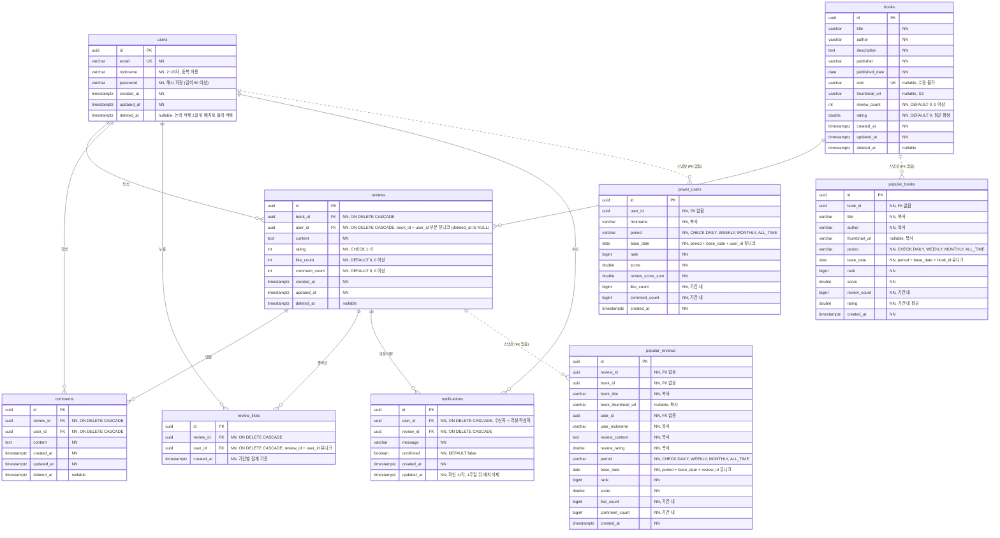

# {팀 이름}
[](https://codecov.io/github/kmg-git/sb15-deokhugam-team1)
[팀 협업 문서](https://app.notion.com/p/cd5d399348a58333bcaf01e2282c83ff)

## 팀원 구성

[팀장 김민규](https://github.com/kmg-git)  
[팀원 박석규](https://github.com/seok0630)  
[팀원 박종우](https://github.com/Park-jongwoo)  
[팀원 김한민](https://github.com/Miiiin06)  
[팀원 이준영](https://github.com/gksrmf1210-droid)  
[팀원 전현진](https://github.com/ginkorn)

---

## 프로젝트 소개

- **프로젝트명**: 덕후감
- **프로젝트 설명**: 책을 좋아하는 사람들이 리뷰와 댓글로 감상을 나누는 도서 리뷰 커뮤니티입니다. 책 뒷면 사진만 올리면 OCR로 ISBN을 인식해 도서 정보를 자동으로 채워 주고, 인기 도서·인기 리뷰·파워 유저 랭킹을 기간별로 보여 줍니다.
- **프로젝트 기간**: 2026.11.20 ~ 2026.11.30 ~ 2026.12.10

---

## 기술 스택

- **Backend**: Java 17, Spring Boot 4.1, Spring Data JPA, Bean Validation, Lombok
- **Database**: {PostgreSQL (pg_trgm 검색 인덱스, 부분 유니크 인덱스)}
- **Infra / CI·CD**: {Docker, AWS ECS·ECR, GitHub Actions}
- **공동 도구**: Git, GitHub, Notion, Discord

---

### 주요 기능

| 도메인 | 기능 |
|---|---|
| 사용자 | 회원가입·로그인, 정보 수정, 논리 삭제 후 1일 뒤 배치로 물리 삭제 |
| 도서 | 도서 CRUD, 카카오 API로 ISBN 기반 정보 조회, OCR로 ISBN 인식, S3 표지 이미지, 키워드 검색·정렬 |
| 리뷰 | 리뷰 CRUD(도서당 1인 1리뷰), 좋아요, 검색·정렬 |
| 댓글 | 리뷰별 댓글 CRUD |
| 알림 | 좋아요·댓글·인기 리뷰 진입 알림, 읽음 처리, 확인 1주일 지난 알림 배치 삭제 |
| 대시보드 | 기간별(일간·주간·월간·전체) 인기 도서, 인기 리뷰, 파워 유저 랭킹 배치 집계 |

모든 목록 API는 커서 기반 페이지네이션(`nextCursor`, `nextAfter`, `hasNext`)을 사용합니다.

---

## 팀원별 구현 기능 상세

<!-- 이미지 또는 GIF를 저장한 뒤 주석을 해제하고 경로를 수정하세요. -->

### 박석규

- **담당 도메인**: 사용자

<!--  -->

- **회원가입과 로그인**
  - `POST /api/users`: 이메일 중복 검사, 닉네임 2~20자, 비밀번호(영문·숫자·특수문자 8~20자) 검증
  - 비밀번호는 BCrypt 해시로 저장, `POST /api/users/login`에서 해시 비교
- **사용자 정보 조회와 수정**
  - `GET /api/users/{userId}`, `PATCH /api/users/{userId}`(닉네임 수정)
  - 요청 헤더 `Deokhugam-Request-User-ID`로 본인 여부 확인
- **회원 탈퇴**
  - `DELETE /api/users/{userId}`: 논리 삭제(`deleted_at`), `DELETE /api/users/{userId}/hard`: 물리 삭제
  - 논리 삭제 1일이 지난 사용자를 배치로 물리 삭제, 삭제 전에 연관 리뷰의 도서 집계를 먼저 재계산

### 전현진

- **담당 도메인**: 도서 (OCR 포함)

<!--  -->

- **도서 CRUD**
  - 도서 등록·조회·수정, 논리 삭제(`deleted_at`)와 물리 삭제
  - `POST /api/books`, `GET·PATCH·DELETE /api/books/{bookId}`, `DELETE /api/books/{bookId}/hard`
  - 표지 이미지는 S3에 업로드하고 URL만 저장
- **ISBN으로 도서 정보 조회**
  - `GET /api/books/info`: 카카오 책 검색 API로 제목·저자·출판사 등을 자동 입력
  - 외부 API 장애에 대비한 타임아웃·예외 처리, WireMock으로 실패 시나리오 테스트
- **OCR로 ISBN 인식**
  - `POST /api/books/isbn/ocr`: 책 사진 → OCR Space로 텍스트 추출 → ISBN 정규식 추출
  - O/0, l/1 같은 오인식 보정, ISBN-10·13 체크섬 검증, ISBN-10 → 13 변환
- **도서 목록 검색과 정렬**
  - 제목·저자·ISBN 키워드 검색, 제목·출판일·평점·리뷰 수 정렬, 커서 페이지네이션
  - `pg_trgm` GIN 인덱스와 `(정렬 컬럼, created_at)` 복합 인덱스로 조회 최적화
- **리뷰 집계 관리**
  - 리뷰 작성·삭제 시 `review_count`, `rating_sum`, `rating`을 원자적 UPDATE 한 문장으로 갱신해 동시 요청에도 값 유실 방지

### 이준영

- **담당 도메인**: 리뷰

<!--  -->

- **리뷰 CRUD**
  - `POST /api/reviews`, `GET·PATCH·DELETE /api/reviews/{reviewId}`, `DELETE /api/reviews/{reviewId}/hard`
  - 도서당 1인 1리뷰를 부분 유니크 인덱스(`book_id, user_id WHERE deleted_at IS NULL`)로 보장
  - 작성·수정·삭제 시 도서 파트의 집계 갱신(`review_count`, `rating`)과 같은 트랜잭션으로 처리
- **리뷰 목록 검색과 정렬**
  - `GET /api/reviews`: 도서·작성자 필터, 키워드 검색, 작성일·평점 정렬, 커서 페이지네이션
  - 요청자 기준 `likedByMe` 표시
- **리뷰 좋아요**
  - `POST /api/reviews/{reviewId}/like`: 좋아요 토글, `(review_id, user_id)` 유니크로 중복 방지
  - `like_count`를 원자적 UPDATE로 갱신

### 김민규

- **담당 도메인**: 댓글

<!--  -->

- **댓글 CRUD**
  - `POST /api/comments`, `GET·PATCH·DELETE /api/comments/{commentId}`, `DELETE /api/comments/{commentId}/hard`
  - 작성자 본인만 수정·삭제 가능
- **리뷰별 댓글 목록**
  - `GET /api/comments?reviewId=`: 작성일 정렬, 커서 페이지네이션
  - `(review_id, created_at)` 인덱스로 조회 최적화
- **리뷰 댓글 수 관리**
  - 댓글 작성·삭제 시 리뷰의 `comment_count`를 원자적 UPDATE로 갱신

### 김한민

- **담당 도메인**: 알림

<!--  -->

- **알림 생성**
  - 내 리뷰에 좋아요·댓글이 달리거나, 내 리뷰가 인기 리뷰 순위에 들면 리뷰 작성자에게 알림 생성
- **알림 목록과 읽음 처리**
  - `GET /api/notifications`: 사용자별 알림 목록, 커서 페이지네이션
  - `PATCH /api/notifications/{notificationId}`: 개별 읽음, `PATCH /api/notifications/read-all`: 전체 읽음
- **오래된 알림 정리 배치**
  - 확인한 지 1주일이 지난 알림을 배치로 삭제 (`confirmed = true` 부분 인덱스 활용)

### 박종우

- **담당 도메인**: 대시보드

<!--  -->

- **인기 도서 랭킹**
  - `GET /api/books/popular`: 기간 내 리뷰 수·평점으로 점수 계산
- **인기 리뷰 랭킹**
  - `GET /api/reviews/popular`: 기간 내 좋아요 수·댓글 수로 점수 계산
- **파워 유저 랭킹**
  - `GET /api/users/power`: 리뷰 인기 점수, 좋아요·댓글 활동량으로 점수 계산
- **랭킹 집계 배치**
  - 일간·주간·월간·전체(`DAILY`, `WEEKLY`, `MONTHLY`, `ALL_TIME`) 기간별로 순위를 계산해 스냅샷 테이블에 저장
  - `(period, base_date, rank)` 인덱스로 조회, 커서 페이지네이션

---

## 파일 구조

<!-- 아래 예시를 실제 프로젝트의 패키지 구조에 맞게 수정하세요. -->

```text
.
└── com.example.sb15deokhugamteam1/
    ├── client/
    ├── config/
    ├── controller/
    ├── dto/
    │   ├── page/
    │   ├── request/
    │   └── response/
    ├── entity/
    ├── exception/
    │   ├── book/
    │   ├── comments/
    │   ├── dashboard/
    │   ├── notifications/
    │   ├── review/
    │   └── user/
    ├── mapper/
    │   ├── dto/
    │   └── page/
    ├── repository/
    ├── S3/
    └── service/
```

---

## ERD 구조도


## 구현 홈페이지

[서비스 접속](https://example.com)

---

## 프로젝트 회고록

- [팀 회고록](https://example.com/retrospective)
- [발표 자료](https://example.com/presentation)

