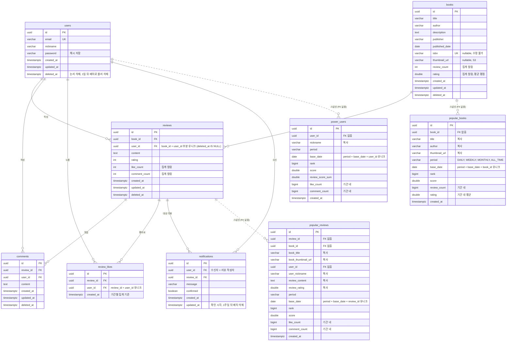

# {팀 이름}

[팀 협업 문서](https://example.com/team-notion)

## 팀원 구성

[{팀원 1 이름}](https://github.com/github-id-1)  
[{팀원 2 이름}](https://github.com/github-id-2)  
[{팀원 3 이름}](https://github.com/github-id-3)  
[{팀원 4 이름}](https://github.com/github-id-4)  
[{팀원 5 이름}](https://github.com/github-id-5)  
[{팀원 6 이름}](https://github.com/github-id-6)

---

## 프로젝트 소개

- **프로젝트명**: {프로젝트 이름}
- **프로젝트 설명**: {누가 어떤 문제를 해결하기 위해 사용하는 서비스인지 한두 문장으로 작성}
- **프로젝트 기간**: YYYY.MM.DD ~ YYYY.MM.DD

---

## 기술 스택

- **Backend**: Java, Spring Boot, Spring Data JPA
- **Database**: {사용한 데이터베이스}
- **Infra / CI·CD**: {사용한 배포 및 자동화 도구}
- **공동 도구**: Git, GitHub, Notion, Discord

---

## 팀원별 구현 기능 상세

<!-- 이미지 또는 GIF를 저장한 뒤 주석을 해제하고 경로를 수정하세요. -->

### {팀원 1 이름}

- **담당 도메인**: {도메인명}

<!--  -->

- **{구현 기능 1}**
  - {기능의 동작과 직접 구현한 내용}
  - {주요 API나 처리 방식}
- **{구현 기능 2}**
  - {기능의 동작과 직접 구현한 내용}

### {팀원 2 이름}

- **담당 도메인**: {도메인명}

<!--  -->

- **{구현 기능 1}**
  - {기능의 동작과 직접 구현한 내용}
  - {주요 API나 처리 방식}
- **{구현 기능 2}**
  - {기능의 동작과 직접 구현한 내용}

### {팀원 3 이름}

- **담당 도메인**: {도메인명}

<!--  -->

- **{구현 기능 1}**
  - {기능의 동작과 직접 구현한 내용}
  - {주요 API나 처리 방식}
- **{구현 기능 2}**
  - {기능의 동작과 직접 구현한 내용}

### {팀원 4 이름}

- **담당 도메인**: {도메인명}

<!--  -->

- **{구현 기능 1}**
  - {기능의 동작과 직접 구현한 내용}
  - {주요 API나 처리 방식}
- **{구현 기능 2}**
  - {기능의 동작과 직접 구현한 내용}

### {팀원 5 이름}

- **담당 도메인**: {도메인명}

<!--  -->

- **{구현 기능 1}**
  - {기능의 동작과 직접 구현한 내용}
  - {주요 API나 처리 방식}
- **{구현 기능 2}**
  - {기능의 동작과 직접 구현한 내용}

### {팀원 6 이름}

- **담당 도메인**: {도메인명}

<!--  -->

- **{구현 기능 1}**
  - {기능의 동작과 직접 구현한 내용}
  - {주요 API나 처리 방식}
- **{구현 기능 2}**
  - {기능의 동작과 직접 구현한 내용}

---

## 파일 구조

<!-- 아래 예시를 실제 프로젝트의 패키지 구조에 맞게 수정하세요. -->

```text
.
├── docs/
│   └── images/
├── src/
│   ├── main/
│   │   ├── java/com/example/project/
│   │   │   ├── global/
│   │   │   └── domain/
│   │   │       └── {도메인명}/
│   │   │           ├── controller/
│   │   │           ├── service/
│   │   │           ├── repository/
│   │   │           ├── entity/
│   │   │           └── dto/
│   │   └── resources/
│   └── test/
├── build.gradle
└── README.md
```

---

## ERD 구조도


## 구현 홈페이지

[서비스 접속](https://example.com)

---

## 프로젝트 회고록

- [팀 회고록](https://example.com/retrospective)
- [발표 자료](https://example.com/presentation)

